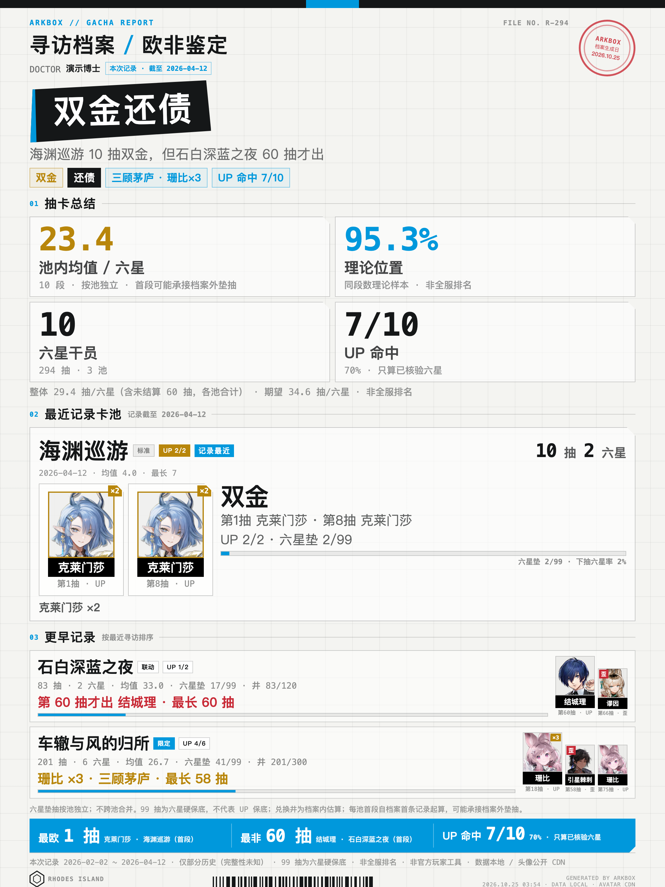

# ArkBox · 明日方舟寻访档案

中文 | [English](README_EN.md)

一个本地优先的《明日方舟》抽卡分析工具：通过森空岛 App 授权，读取官方可查寻访记录，生成
**抽卡海报**与响应式长报告（页头带入职天数）；另有「我的干员」独立命令，可按职业/星级/等级/潜能/时装
筛选自己的干员并生成图鉴页。



非官方玩家工具，与鹰角网络无隶属或授权关系。代码 MIT，游戏数据与素材版权归原权利方。

## 开始之前：你需要什么

| 依赖 | 必需程度 | 说明 |
|---|---|---|
| Python 3.9+ | 必需 | macOS 自带即可；Windows 到 [python.org](https://www.python.org/downloads/) 安装（勾选 Add python.org to PATH） |
| 森空岛 App | 必需（登录功能） | 手机安装并已绑定明日方舟角色，登录时扫码授权；只用离线记录分析（`--records`）则不需要 |
| Chrome / Edge / Chromium | 可选 | 生成海报 PNG 用；没有时交付 HTML，可自行截图 |
| `pip3 install qrcode` | 可选 | 登录二维码本地生成；不装则降级为本地 HTML 页（经公开 QR 服务渲染，只发送一次性 scanId） |

**Windows 用户注意**：命令行里的 `python3` 请换成 `python` 或 `py -3`，其余完全一致。

**纯标准库零依赖**：除上表可选项外不安装任何第三方包，全部网络行为都写在源码里
（见 SKILL.md「网络出口清单」），凭证只存本地 `~/.arkbox/`（权限 600），可自行审计。

## 跨平台

- macOS / Windows / Linux 都可运行，Python 3.9+，零第三方运行依赖。
- 生成 PNG 需要本机 Chrome / Edge / Chromium；找不到浏览器时仍会生成 HTML，不会阻断主流程。
- 登录二维码：有 `qrcode` 时生成本地 PNG（`pip3 install qrcode`，推荐）；没有时生成本地 HTML（通过公开 QR 服务渲染，只发送一次性 scanId，不含账号凭证），不会因缺库崩溃。
- 图片、字体、CDN 的可达性会影响视觉效果；数据与 HTML 结构在各平台一致。

## 安装

方式一：git clone（以后更新方便）

```bash
git clone https://github.com/chenzefeng0731/arkbox.git arkbox
cd arkbox
python3 install.py
```

方式二：不用 git——GitHub 页面绿色 Code 按钮 → Download ZIP，解压后进目录执行同一条命令。

安装器自动探测本机的 Agent skills 目录并把 skill 装进去；探测不到时装到通用位置
`~/.arkbox/skill/arkbox`，不影响使用——让 Agent 读取其中的 `SKILL.md` 调用 `scripts/`，
或直接运行 CLI（真正跨 Agent 的公约数是 Python CLI）。特殊需要可用 `--target <目录>`
指定位置，见 `python3 install.py --help`。

安装后在 Agent 里直接说：

> 用 arkbox 分析我的明日方舟抽卡记录，同时生成海报和 HTML

不安装也可以直接用仓库里的脚本：

```bash
python3 skill/arkbox/scripts/ark_gacha.py analyze --poster --html
```

## 首次登录

```bash
python3 skill/arkbox/scripts/skland_core.py login
```

用森空岛 App 扫码，或在终端选择手机号 + 验证码。凭证保存在 `~/.arkbox/credentials.json`（权限 600）。

环境有问题时先跑：

```bash
python3 skill/arkbox/scripts/ark_doctor.py
```

大多数“凭证失效”不需要重新扫码：ArkBox 会用已保存的 `hg_token` 自动续期；只有 `hg_token`
也失效时才需要重新登录。

**登录能管多久？** 官方没有公开有效期承诺。社区工具的普遍经验：不修改密码、不在森空岛 App
里登出或清理登录设备，一次登录可以一直用；做了这些操作会立即失效。失效后 `ark_doctor.py`
会明确提示，重新运行上面的 login 即可，`~/.arkbox/archive/` 里的历史归档不受影响。

## 常用命令

```bash
# 先看效果（无需登录，使用合成 demo 数据）
python3 skill/arkbox/scripts/ark_gacha.py analyze \
  --records fixtures/demo-records.jsonl --nick 演示博士 --poster --html

# 抽卡海报 + 长 HTML（最精简的通用交付）
python3 skill/arkbox/scripts/ark_gacha.py analyze --poster --html

# 生成可发布的公开站点（Qoder Sites）
python3 skill/arkbox/scripts/ark_gacha.py analyze \
  --site --site-dir site --poster --quiet

# 离线分析
python3 skill/arkbox/scripts/ark_gacha.py analyze \
  --records records.json --nick 博士 --poster --html
```

`--poster` 默认只保留海报 PNG，源 HTML 自动删除；需要编辑源文件时加 `--keep-poster-source`。

## 入职信息

报告页头会在昵称后展示 `入职 2024-07-14 · 834 天`（示例）。数据来自森空岛
`status.registerTs`；离线记录没有账号档案时自动隐藏，不影响抽卡报告。

## 交付物

- **抽卡海报**：1080×1440 逻辑尺寸，2x 渲染输出 2160×2880 PNG（高分屏与社媒压缩都清晰），发社媒/评论区。
- **报告**：Qoder 用户发布为固定站点；其他 Agent 用户拿自包含 `report.html`。
- 不交付海报源 HTML、手机截图、Markdown、说明文档；这些只用于源文件和验收。

## 数据与隐私

- **分享产物（海报/HTML/站点/图鉴）不展示 UID**：UID 不进入报告模型，只存在于本地凭证与归档目录；`--hide-nick` 可隐藏昵称。
- 公开站点固定昵称“博士”、不含 UID、`noindex` + `robots.txt` 禁止抓取；海报是单独文件，仍保留昵称。
- 只使用展示需要的玩家字段；不把理智、最后在线、基建、招募状态写进公开产物。
- 原始记录归档在 `~/.arkbox/archive/`，不会上传。
- 凭证等同账号钥匙，不要分享 `~/.arkbox/credentials.json`；登出用 `skland_core.py logout`（彻底解除授权请在森空岛 App 授权管理里操作）。

## 测试

```bash
# 单元与口径自测（不联网、不读凭证）
python3 skill/arkbox/scripts/selftest.py

# 端到端冒烟（不登录：fixtures 全链路出海报/报告/站点，断言数字与隐私）
python3 tests/e2e_check.py
```

单元自测覆盖抽卡模型、按池独立口径、零金、标题、隐私、站点、入职天数等边界；
端到端冒烟走真实 CLI。CI 在 macOS/Windows/Linux × Python 3.9/3.12 上每次提交自动跑全部测试。

## 目录

```
skill/arkbox/          skill 源（SKILL.md + scripts + references）
fixtures/              demo 记录（复刻真实档案结构，无账号信息，时间轴已平移）
tests/                 端到端冒烟（e2e_check.py）
install.py             跨平台安装器
docs/                  设计、验收、演示产物与发布清单
LICENSE                MIT（仅代码）
THIRD_PARTY_NOTICES.md 游戏数据/头像/第三方组件说明
docs/PUBLISHING.md    上架 GitHub 前的隐私/验证清单
```

## 已知边界

- 森空岛只返回可查窗口内的记录，无法证明账号全历史；报告默认写“本档案区间”。
- 标准/中坚历史无法证明完整，默认**不跨池累计**；首段可能承接档案外垫抽。
- 标准/中坚/特殊池的 UP 兑换井规则不统一，不硬算；限定 300、联动 120 只展示档案内进度。
- 截图 OCR 与需要登录态/签名的官方记录链接不自动导入；公开 JSON 链接可用 `--records URL`。
- **部分网络环境（如中国大陆直连）访问 GitHub raw 不稳定**：干员元数据下载已内置
  jsdelivr 镜像回退，页面头像加载失败也会自动换镜像；卡池表镜像（PRTS 站）一般可直连。
  若拉取失败，工具会降级（池型/UP 显示“待核”），不影响基础统计与报告生成。
- 接口来自社区对森空岛/官网的逆向分析，官方改版可能导致登录或拉取失效；
  失效时请带 `ark_doctor.py` 输出到 issue 反馈。
