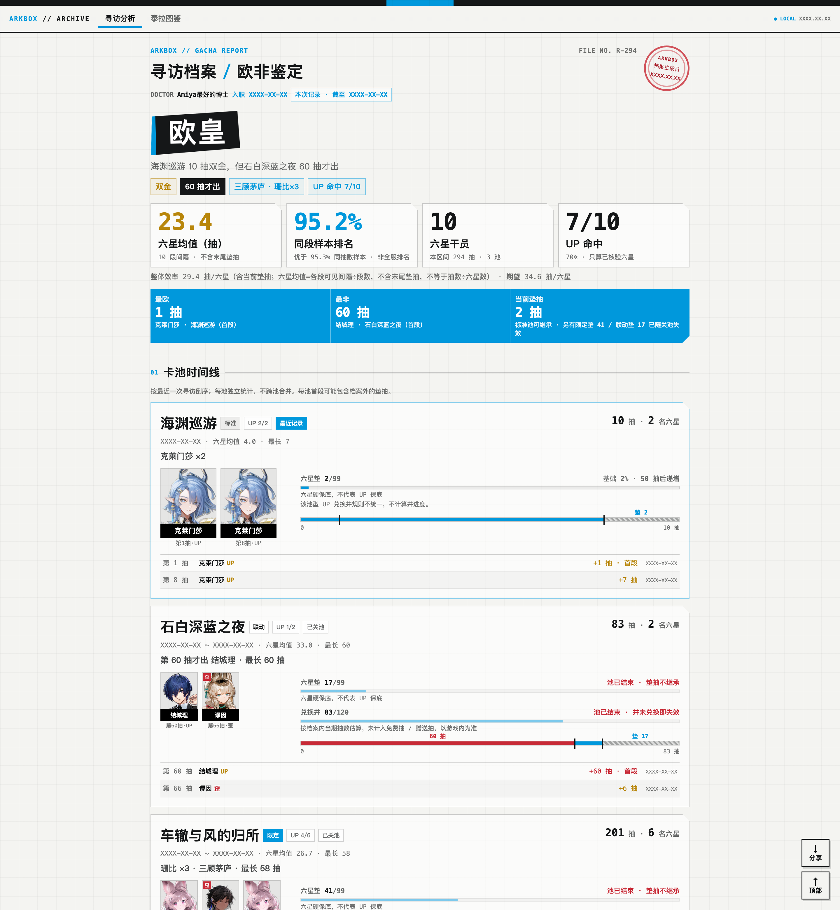

# ArkBox · 明日方舟寻访档案

[](https://github.com/chenzefeng0731/arkbox/actions/workflows/test.yml)

**ArkBox 是明日方舟玩家的本地寻访档案馆**——森空岛扫码授权后，把官方可查的寻访记录
变成一份工业档案风的个人档案：寻访分析、泰拉图鉴、分享海报，全部本地生成、不含 UID。

> 把你的明日方舟抽卡史，装订成一份能晒的档案。本地优先、口径诚实、舟味设计。

<p align="center">
  
</p>
<p align="center">
  
  
</p>

非官方玩家工具，与鹰角网络无隶属或授权关系；**仅支持国服官服账号**（寻访记录仅官服渠道可查，B 服 / 国际服不可用）。代码 MIT，游戏数据与素材版权归原权利方。

## 30 秒看效果（无需登录）

```bash
git clone https://github.com/chenzefeng0731/arkbox.git arkbox
cd arkbox
# Windows 用户请把 python3 换成 python
python3 skill/arkbox/scripts/ark_gacha.py analyze \
  --records fixtures/demo-records.jsonl --nick 演示博士 --tenure 2024-07-14 \
  --poster --html
```

用合成演示数据跑通完整分析，产出**抽卡海报 PNG + 单页档案报告**。未登录时没有干员持有数据，档案页为单页形态；扫码登录后重跑同一命令，即升级为「寻访分析 + 泰拉图鉴」双页签并可导出分享图——上方展示图的完整效果。

## 三个支柱

- **晒得出**：2160×2880 抽卡海报与档案页内一键分享图，称号由数据规则生成，每项指标都有口径注脚。
- **看得懂**：按池独立统计、池内均值 / 整体效率 / 当前垫抽 / 最长间隔四口径分开；「理论位置」对标同段数理论样本，**不是全服排名**；数据缺口明示，不虚构生涯全量。
- **留得住**：记录本地归档、凭证权限 600；分享产物（海报/HTML/站点/图鉴）一律不含 UID，`--hide-nick` 可再隐昵称。

## 开始之前

| 依赖 | 必需程度 | 说明 |
|---|---|---|
| Python 3.9+ | 必需 | macOS 自带；Windows 到 [python.org](https://www.python.org/downloads/) 安装（勾选 Add python.org to PATH） |
| 森空岛 App | 登录时需要 | 手机安装并绑定明日方舟角色，扫码授权；只玩离线记录（`--records`）则不需要 |
| Chrome / Edge / Chromium | 可选 | 生成海报 PNG 用；没有时交付 HTML，可自行截图 |
| `pip3 install qrcode` | 可选 | 登录二维码本地生成；不装则降级为本地 HTML 页（经公开 QR 服务渲染，只发送一次性 scanId） |

- **Windows 用户注意**：命令里的 `python3` 换成 `python` 或 `py -3`，其余一致。
- **纯标准库零依赖**：除上表可选项外不装任何第三方包，全部网络行为写在源码里（见 SKILL.md「网络出口清单」）；macOS / Windows / Linux 均可运行，数据与 HTML 结构各平台一致，图片字体的可达性只影响视觉效果。

## 安装

```bash
git clone https://github.com/chenzefeng0731/arkbox.git arkbox && cd arkbox
python3 install.py
```

方式二（不用 git）：GitHub 页面绿色 Code 按钮 → Download ZIP，解压后执行同一条命令。

安装器自动探测本机 Agent skills 目录并装入 skill；探测不到时装到通用位置 `~/.arkbox/skill/arkbox`——让 Agent 读取其中 `SKILL.md` 调用 `scripts/`，或直接运行 CLI（真正跨 Agent 的公约数是 Python CLI）。特殊需要 `--target <目录>`，见 `python3 install.py --help`。

## 首次登录

```bash
python3 skill/arkbox/scripts/skland_core.py login   # 森空岛 App 扫码；凭证存 ~/.arkbox/credentials.json（权限 600）
python3 skill/arkbox/scripts/ark_doctor.py          # 环境自检（Python / 浏览器 / qrcode / 凭证 / 归档）
```

大多数"凭证失效"不用重新扫码：ArkBox 会用已保存的 `hg_token` 自动续期。官方未承诺有效期；社区经验是不改密码、不在森空岛 App 登出或清理设备即可长期使用，失效后 doctor 会明确提示重登，`~/.arkbox/archive/` 的历史归档不受影响。

## 常用命令

```bash
# 抽卡海报 + 档案页 HTML（最精简的通用交付）
python3 skill/arkbox/scripts/ark_gacha.py analyze --poster --html

# 离线分析自己的记录文件
python3 skill/arkbox/scripts/ark_gacha.py analyze --records records.json --nick 博士 --poster --html

# 我的干员：筛选 + 图鉴页
python3 skill/arkbox/scripts/ark_box.py gallery --open
```

`--poster` 默认只保留海报 PNG（源 HTML 自动删除，编辑加 `--keep-poster-source`）；固定站点发布（Qoder Sites）见 [docs/PUBLISHING.md](docs/PUBLISHING.md)。

## 交付物

- **抽卡海报**：1080×1440 逻辑尺寸、2x 渲染 2160×2880 PNG，高分屏与社媒压缩都清晰。
- **全能档案页**（`analyze --html`）：一个自包含 HTML——「寻访分析」（池时间线/池型对照/称号候选/审计表）+「泰拉图鉴」（全服 138 名六星画成六边形大陆图，点击地区看收集档案与"差一枚"清单）；右下角「分享」弹层导出两张海报 PNG。未登录或离线 `--records` 自动降级为单页报告。
- **我的干员**：按职业/星级/等级/潜能/时装筛选，生成图鉴式浏览页。
- 不交付海报源 HTML、手机截图、Markdown——那些只用于源文件和验收。

## 在 AI Agent 中使用

ArkBox 原生附带通用 Skill（`skill/arkbox/SKILL.md`）：安装后直接在 Agent 里说「用 arkbox 分析我的明日方舟抽卡记录，生成海报和 HTML」。`--json` 机器可读、`--audit` 口径校验表、退出码明确——任何能执行本地命令的 Agent 驱动的都是同一套核心程序，数字由 ArkBox 算，Agent 只负责解说，不许篡改统计值。

## 数据与隐私

- **分享产物（海报/HTML/站点/图鉴）不展示 UID**：UID 不进入报告模型，只存在于本地凭证与归档目录；`--hide-nick` 隐藏昵称，公开站点固定"博士"并 `noindex` + `robots.txt` 禁止抓取。
- 原始记录归档在 `~/.arkbox/archive/` 不会上传；凭证等同账号钥匙，不要分享 `~/.arkbox/credentials.json`，登出用 `skland_core.py logout`（彻底解除授权请在森空岛 App 授权管理里操作）。

## 测试与演示图复刻

```bash
python3 skill/arkbox/scripts/selftest.py    # 单元与口径自测（不联网、不读凭证）
python3 tests/e2e_check.py                  # 端到端冒烟：fixtures 全链路 + 数字与隐私断言
python3 tools/make_demo_images.py           # 复刻上方三张演示图（合成数据；需 Chrome，首次联网下载元数据约 10MB）
```

CI 在 macOS/Windows/Linux × Python 3.9/3.12 上每次提交自动跑全部测试。

## 常见问题

- **会不会封号 / 盗号？** 只读官方可查接口、低频请求、不修改游戏客户端；凭证只存本地（权限 600）不上传。但这是非官方工具，无法承诺零风险，介意请勿使用。
- **为什么我的记录不全 / 只有几个月？** 森空岛只返回官方可查窗口内的记录，不是工具漏了；报告默认写"本档案区间"。
- **为什么我的平均抽数和别人不一样 / 为什么没有全服排名？** 统计按卡池独立、不跨池累计，池内均值 / 整体效率 / 当前垫抽 / 最长间隔四口径分开，跨池拉平会失真；"理论位置"是与同段数理论样本的比较，本地工具拿不到全服数据，不做排名。
- **Windows 怎么用？** 命令里 `python3` 换成 `python` 或 `py -3`；生成 PNG 需要本机 Chrome / Edge / Chromium，没有时仍会生成 HTML。
- **可以商用 / 二次分发吗？** 代码 MIT 可自由使用；游戏名称、头像、数据版权归鹰角网络等原权利方，本项目非官方、非商业。

## 已知边界

- 森空岛只返回可查窗口内的记录，无法证明账号全历史；每池首段可能承接档案外垫抽，不做校正也不剔除。
- 标准/中坚历史无法证明完整，默认**不跨池累计**；标准/中坚/特殊池的 UP 兑换井规则不统一，不硬算（限定 300、联动 120 只展示档案内进度）。
- 截图 OCR 与需要登录态/签名的官方记录链接不自动导入；公开 JSON 链接可用 `--records URL`。
- **大陆直连访问 GitHub raw 不稳定**：干员元数据下载已内置 jsdelivr 镜像回退，页面头像加载失败自动换镜像；卡池表镜像（PRTS 站）一般可直连。若拉取失败会降级（池型/UP 显示"待核"），不影响基础统计与报告生成。
- 接口来自社区对森空岛/官网的逆向分析，官方改版可能导致登录或拉取失效；失效时请带 `ark_doctor.py` 输出到 issue 反馈。
