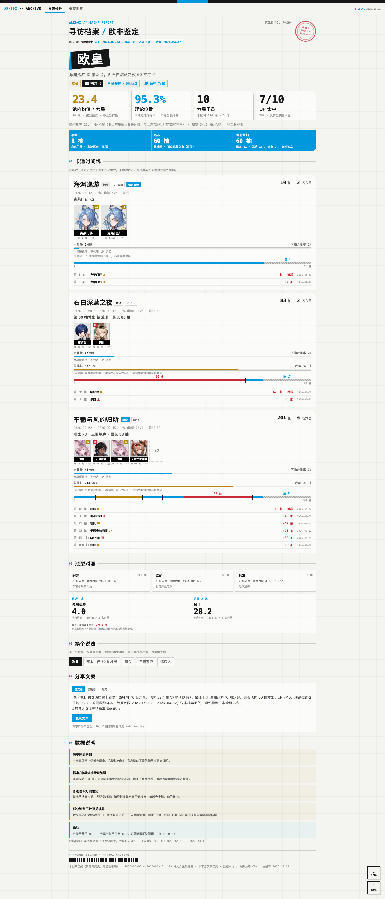
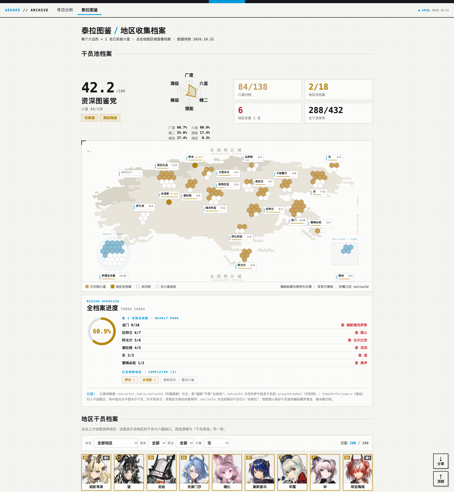
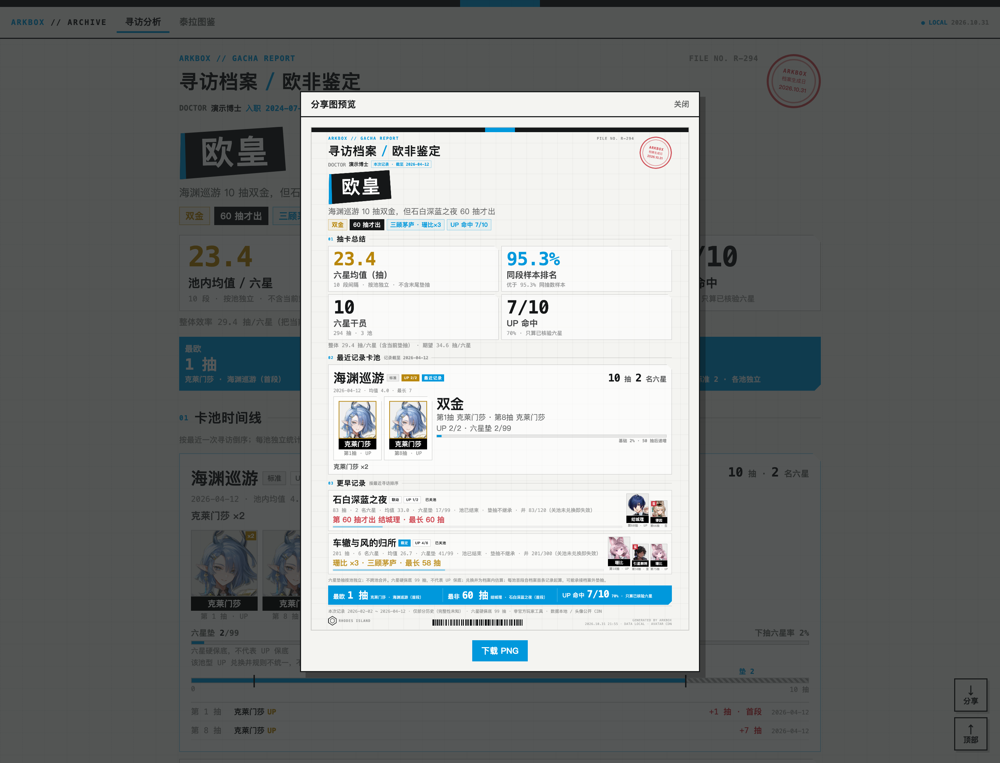
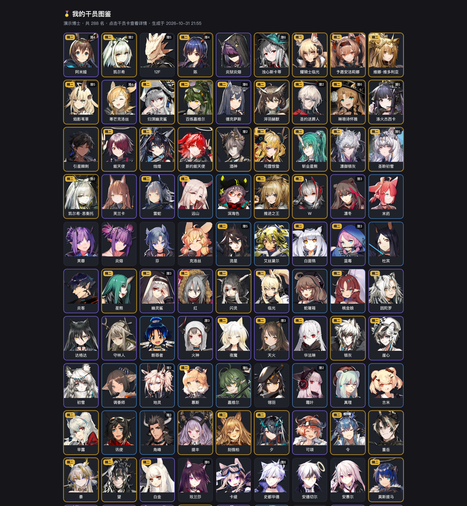

# ArkBox · 玩法与演示图

README 首页放不下的细节都在这一页。所有图都用仓库自带的合成演示数据生成
（`python3 tools/make_demo_images.py` 一键复刻），不对应任何真实账号。

## 抽卡海报

2160×2880 PNG（2x 渲染）。称号——欧皇、三顾茅庐、保底人——按数据规则生成，
每个数字底下都标了口径。发社媒、发评论区都够清晰。

## 寻访分析（完整档案页）

首页截图只是开头。往下还有卡池时间线、单池明细、称号候选切换、分享文案和口径审计表。

## 泰拉图鉴

全服 138 名六星画成一张六边形大陆图，一个六边形 = 一名六星。点地区看收集档案，
"差一枚"清单直接告诉你下一个该抽谁。

## 分享弹层

档案页右下角「分享」，预览并下载寻访 / 泰拉两张海报 PNG，不联网。

## 我的干员

`ark_box.py gallery` 生成的图鉴页，点干员卡看练度详情。支持按职业 / 星级 / 等级 /
潜能 / 时装筛选（截图里是全量演示数据）。

---

[← 回到 README](../README.md)
